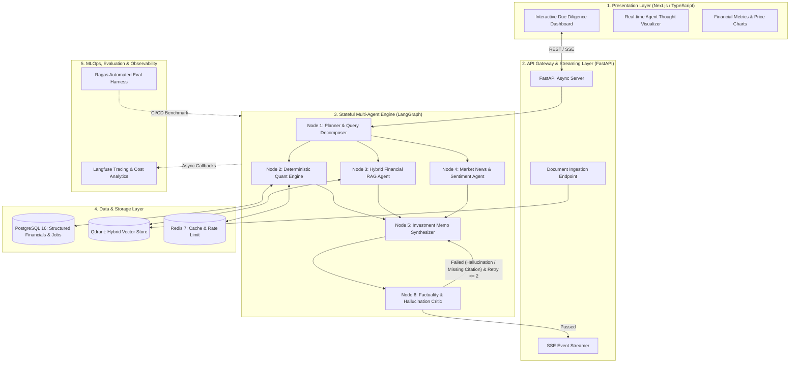

# MASTER TECHNICAL SPECIFICATION: MULTI-AGENT FINANCIAL DUE DILIGENCE & QUANTITATIVE INTELLIGENCE PLATFORM

> **INSTRUCTIONS FOR AI CODING ASSISTANTS (CURSOR / CLAUDE CODE / WINDSURF):**
> This document is the single source of truth for the architecture, data schemas, agent workflows, evaluation metrics, and implementation standards of this project.
> 1. **Strict Adherence:** Do not simplify the architecture into a basic single-prompt chatbot or monolithic script. Maintain strict separation of concerns (`api/`, `agents/`, `rag/`, `quant/`, `evaluation/`).
> 2. **Zero-Hallucination Math Policy:** Never allow an LLM to calculate financial ratios or aggregate raw numbers. All mathematical computations MUST be executed deterministically in Python (`src/quant/ratio_calculator.py`) and passed into the LLM context as verified JSON facts.
> 3. **Type Safety & Async First:** Enforce Python 3.11+ type hints, Pydantic v2 validation, and `async/await` across all I/O-bound operations (FastAPI, Qdrant, PostgreSQL, LLM calls).
> 4. **Incremental Execution:** When asked to implement a phase, read the corresponding schemas and contracts in this file first, generate modular production-grade code, and include unit tests.

---

## 1. EXECUTIVE SUMMARY & PROBLEM STATEMENT

### 1.1. Project Vision
Build a production-grade, end-to-end **AI Financial Due Diligence & Quantitative Intelligence Platform** capable of ingesting multi-modal financial data (structured balance sheets, income statements, cash flow statements, unstructured PDF financial reports/audit footnotes, and real-time market news) to synthesize institutional-grade **Investment Due Diligence Memos**.

### 1.2. Core Engineering Challenges Solved
1. **Table Destruction in Standard RAG:** Naive text chunking splits rows and columns of financial tables, destroying numerical context. *Solution:* Layout-aware PDF table extraction preserving full Markdown/HTML table structures with parent-child hierarchical indexing.
2. **Numerical Hallucination by LLMs:** LLMs frequently miscalculate ratios or confuse fiscal periods. *Solution:* Deterministic Quantitative Engine + a cyclic **Critic/Guardrail Agent** in LangGraph that cross-verifies every figure in the generated report against ground-truth JSON metrics before release.
3. **Lack of Observability & Evaluation:** Most AI prototypes lack measurable accuracy. *Solution:* Full trace instrumentation via **Langfuse** and automated CI/CD evaluation pipelines using **Ragas**.

---

## 2. TECHNOLOGY STACK & INFRASTRUCTURE

| Layer | Technology / Library | Purpose & Justification |
| :--- | :--- | :--- |
| **Language & Runtime** | Python 3.11+, `uv` | Fast dependency resolution, strict typing, async concurrency. |
| **Agent Orchestration** | `langgraph`, `langchain-core` | Stateful cyclic graph orchestration, conditional routing, self-correction loops. |
| **LLM Providers** | OpenAI (`gpt-4o` / `gpt-4o-mini`) or Anthropic (`claude-3-5-sonnet`) | `gpt-4o-mini` for routing/extraction; `gpt-4o` / `claude-3-5-sonnet` for synthesis & critique. |
| **PDF & Table Parsing** | `pdfplumber`, `unstructured` / `MinerU` | Preserving complex financial statement tables as structured Markdown. |
| **Embeddings & Reranking** | `BAAI/bge-m3` (Dense+Sparse) or `text-embedding-3-small`, `BAAI/bge-reranker-large` | Multilingual support (English & Vietnamese financial reports) + Cross-Encoder precision. |
| **Vector & Lexical Search** | `Qdrant` + `rank_bm25` | Hybrid search combining semantic dense vectors and exact keyword/number matching. |
| **Relational & Cache DB** | `PostgreSQL 16` (SQLAlchemy 2.0 async) + `Redis 7` | Storing structured financial time-series, job states, and caching API responses. |
| **NLP Sentiment Model** | `ProsusAI/finbert` (EN) / `wonrax/phobert-base-vietnamese-sentiment` (VI) | Dedicated encoder models for low-latency news sentiment scoring. |
| **Quantitative Data** | `yfinance`, `pandas`, `numpy` | Fetching OHLCV, financial statements, and computing deterministic financial ratios. |
| **Backend API** | `FastAPI`, `Uvicorn`, `sse-starlette` | Async REST endpoints and Server-Sent Events (SSE) for real-time agent thought streaming. |
| **Observability & Eval** | `Langfuse` (self-hosted or cloud), `Ragas`, `Pytest` | Token/latency tracing, cost analytics, and automated RAG faithfulness benchmarking. |
| **Frontend UI** | `Next.js 14` (TypeScript, TailwindCSS, Recharts/TradingView) | Interactive dashboard with live agent execution graph, candlestick charts, and cited reports. |
| **DevOps & Packaging** | `Docker`, `docker-compose`, `GitHub Actions` | Multi-container orchestration and automated testing/eval pipelines. |

---

## 3. SYSTEM ARCHITECTURE & DATA FLOW

### 3.1. End-to-End Architecture Diagram



---

## 4. DATA INGESTION & HYBRID RAG SPECIFICATION

### 4.1. Layout-Aware Financial PDF Ingestion Pipeline
Standard fixed-size chunking (`chunk_size=500`) corrupts balance sheets and income statements. Implement the following 4-step pipeline in `src/rag/parser.py`:

1. **Layout Detection & Table Extraction:**
   - Iterate page-by-page through uploaded PDF annual/quarterly reports.
   - Detect bounding boxes of tables using `pdfplumber` (or `MinerU`).
   - Convert extracted tables into clean **Markdown Tables** (`| Line Item | FY2024 | FY2025 |`).
   - Replace the raw table text on the page with a structured placeholder tag `[TABLE_BLOCK_ID]` during narrative segmentation so tables are never split mid-row.
2. **Metadata Enrichment:**
   Every document chunk MUST carry strict metadata for pre-filtering in Qdrant:
   ```python
   class DocumentChunkMetadata(BaseModel):
       doc_id: str
       ticker: str  # e.g., "AAPL", "FPT"
       company_name: str
       fiscal_year: int  # e.g., 2025
       fiscal_period: str  # e.g., "FY", "Q1", "Q2", "Q3", "Q4"
       report_type: str  # e.g., "10-K", "Annual_Report", "Audit_Notes"
       section_title: str  # e.g., "Notes to Consolidated Financial Statements - Debt"
       page_number: int
       content_type: Literal["narrative", "table"]
   ```
3. **Chunking Strategy:**
   - **Tables:** Keep entire tables intact as single chunks (up to 2,048 tokens). Prepend a generated 2-sentence summary header above the Markdown table (e.g., *"Consolidated Balance Sheet for AAPL as of FY2025 showing Total Assets and Short-term Debt"*).
   - **Narrative Text (MD&A, Audit Footnotes):** Recursive character splitting with `chunk_size=800` tokens, `chunk_overlap=120` tokens, respecting paragraph and section boundaries.

### 4.2. Hybrid Search & Cross-Encoder Reranking (`src/rag/hybrid_retriever.py`)
Financial queries require both semantic understanding (e.g., *"liquidity risk"*) and exact lexical matching (e.g., *"Note 14"*, *"VND 4,520 billion"*, *"EBITDA"*).

1. **Metadata Pre-Filtering:** Filter Qdrant vectors strictly by `ticker == state["ticker"]` and `fiscal_year >= state["target_year"] - 1`.
2. **Dual Retrieval:**
   - **Dense Retrieval:** Cosine similarity over `BAAI/bge-m3` embeddings (`top_k = 25`).
   - **Sparse Retrieval:** BM25 lexical scoring over tokenized chunks (`top_k = 25`).
3. **Reciprocal Rank Fusion (RRF):**
   Combine dense and sparse rankings using RRF with smoothing constant $k = 60$:
   $$RRF(d) = \frac{1}{k + r_{\text{dense}}(d)} + \frac{1}{k + r_{\text{sparse}}(d)}$$
   Select top $N = 20$ unique candidate chunks.
4. **Cross-Encoder Reranking (`src/rag/reranker.py`):**
   - Pass `(user_query, candidate_chunk)` pairs through `BAAI/bge-reranker-large`.
   - Sort by cross-encoder relevance logit score and retain top $P = 5$ chunks.
   - Discard any chunk with normalized relevance score $< 0.35$.

---

## 5. QUANTITATIVE ENGINE & SENTIMENT SPECIFICATION

### 5.1. Deterministic Financial Ratio Engine (`src/quant/ratio_calculator.py`)
All financial metrics MUST be calculated in pure Python using `pandas`/`numpy` with safe zero-division handling (`Optional[float]`).

#### Mandatory Ratios to Compute:
1. **Liquidity Ratios:**
   $$\text{Current Ratio} = \frac{\text{Total Current Assets}}{\text{Total Current Liabilities}}$$
   $$\text{Quick Ratio} = \frac{\text{Total Current Assets} - \text{Inventory}}{\text{Total Current Liabilities}}$$
2. **Profitability Ratios:**
   $$\text{Gross Margin} = \frac{\text{Revenue} - \text{Cost of Goods Sold}}{\text{Revenue}}$$
   $$\text{Operating Margin} = \frac{\text{Operating Income (EBIT)}}{\text{Revenue}}$$
   $$\text{Net Profit Margin} = \frac{\text{Net Income}}{\text{Revenue}}$$
   $$\text{ROE} = \frac{\text{Net Income}}{\text{Average Shareholders' Equity}}$$
   $$\text{ROA} = \frac{\text{Net Income}}{\text{Average Total Assets}}$$
3. **Leverage & Solvency Ratios:**
   $$\text{Debt-to-Equity (D/E)} = \frac{\text{Total Debt}}{\text{Total Shareholders' Equity}}$$
   $$\text{Interest Coverage} = \frac{\text{EBIT}}{\text{Interest Expense}}$$
   $$\text{Net Debt / EBITDA} = \frac{\text{Total Debt} - \text{Cash \& Equivalents}}{\text{EBITDA}}$$
4. **Cash Flow Quality:**
   $$\text{Free Cash Flow (FCF)} = \text{Operating Cash Flow} - \text{Capital Expenditures (CapEx)}$$
   $$\text{FCF Conversion} = \frac{\text{Free Cash Flow}}{\text{Net Income}}$$
5. **Growth Metrics (YoY):**
   $$\text{YoY Growth} = \frac{\text{Metric}_{t} - \text{Metric}_{t-1}}{|\text{Metric}_{t-1}|}$$

### 5.2. News & Sentiment Engine (`src/agents/nodes/news_analyzer.py`)
- Fetch the 15 most recent news headlines + snippets for `ticker` (via `yfinance.Ticker(ticker).news` or RSS/NewsAPI).
- Classify each article into `positive`, `neutral`, or `negative` using `ProsusAI/finbert` (or `PhoBERT` for Vietnamese equities).
- Compute aggregate sentiment index $S \in [-1.0, +1.0]$:
  $$S = \frac{1}{N} \sum_{i=1}^{N} \left( P(\text{positive}_i) - P(\text{negative}_i) \right)$$
- Extract top 3 risk headlines (highest $P(\text{negative})$) and top 3 catalyst headlines (highest $P(\text{positive})$) to pass to the Synthesizer.

---

## 6. MULTI-AGENT STATE MACHINE SPECIFICATION (LANGGRAPH)

### 6.1. Graph State Definition (`src/agents/state.py`)

```python
from typing import TypedDict, Annotated, List, Dict, Any, Optional
import operator


class RetrievedContext(BaseModel):
    chunk_id: str
    content: str
    page_number: int
    section_title: str
    rerank_score: float


class CriticIssue(BaseModel):
    claim_text: str
    issue_type: str  # "NUMERICAL_MISMATCH" | "UNSUPPORTED_CLAIM" | "MISSING_CITATION"
    correction_instruction: str


class AgentState(TypedDict):
    # Input parameters
    job_id: str
    ticker: str
    target_year: int
    user_query: str

    # Step 1: Planner outputs
    sub_queries: List[str]
    focus_areas: List[str]

    # Step 2: Parallel worker outputs
    financial_metrics: Dict[str, Any]  # Output from QuantEngine
    retrieved_contexts: List[Dict[str, Any]]  # Serialized RetrievedContext list from HybridRAG
    sentiment_analysis: Dict[str, Any]  # Output from NewsAnalyzer

    # Step 3: Synthesis & Self-Correction Loop
    draft_report: str
    critic_passed: bool
    critic_issues: List[Dict[str, Any]]  # Serialized CriticIssue list
    retry_count: int

    # Execution telemetry
    execution_logs: Annotated[List[str], operator.add]
```

### 6.2. Node Specifications & Routing Logic (`src/agents/graph.py`)

1. **`planner_node`**:
   - Uses structured output (`with_structured_output`) to decompose `user_query` into 3 targeted sub-queries for the Hybrid RAG engine (e.g., debt covenants, revenue segments, contingent liabilities) and identifies key risk areas.
2. **Parallel Fan-Out (`quant_node`, `rag_node`, `news_node`)**:
   - Execute concurrently using LangGraph parallel branches to minimize end-to-end latency.
   - `quant_node` queries PostgreSQL/Redis (falling back to `yfinance`), computes all ratios in Section 5.1, and flags anomalies (e.g., `Current Ratio < 1.0`, `D/E > 2.0`, `FCF < 0` while `Net Income > 0`).
   - `rag_node` executes Hybrid Search + Reranking across `sub_queries`, deduplicates chunks by `chunk_id`, and keeps top 6 highest-scoring contexts.
   - `news_node` runs FinBERT sentiment scoring on recent news.
3. **`synthesizer_node`**:
   - Combines `financial_metrics`, `retrieved_contexts`, and `sentiment_analysis` into a structured Markdown Investment Memo.
   - **Mandatory Citation Rule:** Every factual claim from documents MUST include inline citations `[Page X, Section Y]`. Every financial metric MUST match `financial_metrics` JSON exactly.
   - If `retry_count > 0`, reads `critic_issues` and explicitly fixes every flagged discrepancy.
4. **`critic_node` (Guardrail & Anti-Hallucination Gate)**:
   - Uses an LLM judge (`temperature=0.0`) with structured output (`CriticEvaluation`).
   - Performs a line-by-line audit comparing numbers and assertions in `draft_report` against `financial_metrics` and `retrieved_contexts`.
   - **Conditional Edge (`should_continue`)**:
     - If `critic_passed == True` OR `retry_count >= 2`: route to `END`.
     - If `critic_passed == False` AND `retry_count < 2`: increment `retry_count += 1` and route back to `synthesizer_node`.

### 6.3. Production System Prompts (`src/agents/prompts/`)

#### Synthesizer System Prompt (`synthesizer.py`)
```text
You are a Senior Institutional Equity Research Analyst writing a formal Investment Due Diligence Memo.

STRICT GROUNDING RULES:
1. ZERO FABRICATION: You may ONLY use numbers provided in the [VERIFIED_QUANT_METRICS] JSON block and facts present in the [RETRIEVED_DOCUMENT_CONTEXTS] block.
2. EXACT PRECISION: Do not round or recalculate numbers differently from [VERIFIED_QUANT_METRICS]. If a metric is null/None, explicitly state "Data not disclosed in available filings."
3. MANDATORY CITATIONS: Every qualitative claim or footnote figure extracted from documents MUST be cited inline using the exact format: [Page {page_number}, {section_title}].
4. OBJECTIVE TONE: Highlight both fundamental strengths and financial red flags (e.g., divergence between Net Income and Free Cash Flow, rising short-term debt, negative news sentiment).

REQUIRED REPORT STRUCTURE:
## 1. Executive Summary & Investment Thesis
## 2. Quantitative Financial Health Analysis (Liquidity, Profitability, Leverage, Cash Flow)
## 3. Qualitative Filing Insights & Footnote Risks (With Page Citations)
## 4. Market Sentiment & External Catalysts
## 5. Key Risk Factors & Red Flags
```

#### Critic System Prompt (`critic.py`)
```text
You are a Strict Financial Compliance & Fact-Checking Auditor. Your sole job is to detect hallucinations, numerical mismatches, and unsupported claims in a draft financial report.

Compare [DRAFT_REPORT] against [VERIFIED_QUANT_METRICS] and [RETRIEVED_DOCUMENT_CONTEXTS].

FAIL THE REPORT (`critic_passed = False`) IF ANY OF THE FOLLOWING OCCUR:
1. NUMERICAL_MISMATCH: Any ratio, revenue figure, growth rate, or dollar/VND amount in the draft contradicts [VERIFIED_QUANT_METRICS] or [RETRIEVED_DOCUMENT_CONTEXTS].
2. UNSUPPORTED_CLAIM: The draft states a specific fact, debt covenant, or operational detail that cannot be verified from the provided inputs.
3. MISSING_CITATION: A factual claim derived from a filing lacks a `[Page X, Section]` citation.

If all numbers and claims are 100% faithful to the source data, return `critic_passed = True` and an empty `critic_issues` list. Otherwise, list every exact error with clear correction instructions.
```

---

## 7. DATABASE SCHEMAS & API CONTRACTS

### 7.1. PostgreSQL Schema (`src/core/models.py`)

```sql
CREATE TABLE companies (
    ticker VARCHAR(20) PRIMARY KEY,
    name VARCHAR(255) NOT NULL,
    sector VARCHAR(100),
    currency VARCHAR(10) DEFAULT 'USD',
    updated_at TIMESTAMP WITH TIME ZONE DEFAULT NOW()
);

CREATE TABLE financial_snapshots (
    id UUID PRIMARY KEY DEFAULT gen_random_uuid(),
    ticker VARCHAR(20) REFERENCES companies(ticker) ON DELETE CASCADE,
    fiscal_year INT NOT NULL,
    fiscal_period VARCHAR(10) NOT NULL,
    raw_statements JSONB NOT NULL,      -- Balance sheet, Income, Cash Flow
    computed_ratios JSONB NOT NULL,     -- Deterministic ratios from ratio_calculator.py
    created_at TIMESTAMP WITH TIME ZONE DEFAULT NOW(),
    UNIQUE(ticker, fiscal_year, fiscal_period)
);

CREATE TABLE analysis_jobs (
    job_id UUID PRIMARY KEY DEFAULT gen_random_uuid(),
    ticker VARCHAR(20) NOT NULL,
    target_year INT NOT NULL,
    user_query TEXT NOT NULL,
    status VARCHAR(20) NOT NULL,        -- PENDING | RUNNING | COMPLETED | FAILED
    final_report TEXT,
    critic_passed BOOLEAN,
    retry_count INT DEFAULT 0,
    trace_id VARCHAR(100),              -- Langfuse Trace ID
    latency_ms INT,
    created_at TIMESTAMP WITH TIME ZONE DEFAULT NOW()
);
```

### 7.2. FastAPI Endpoints & SSE Streaming Contract (`src/api/routes/analysis.py`)

#### 1. `POST /api/v1/ingest/document`
- **Request:** `multipart/form-data` (`file: UploadFile`, `ticker: str`, `fiscal_year: int`, `report_type: str`).
- **Response (`202 Accepted`):**
  ```json
  {
    "doc_id": "550e8400-e29b-41d4-a716-446655440000",
    "ticker": "AAPL",
    "chunks_indexed": 142,
    "tables_extracted": 18,
    "status": "INDEXED"
  }
  ```

#### 2. `POST /api/v1/analyze/stream` (Server-Sent Events)
- **Request Body:**
  ```json
  {
    "ticker": "AAPL",
    "target_year": 2025,
    "query": "Evaluate liquidity risks, debt maturity profile, and cash flow quality."
  }
  ```
- **SSE Event Stream Protocol (`text/event-stream`):**
  The backend MUST emit structured JSON events as each LangGraph node transitions:
  ```text
  event: node_update
  data: {"node": "planner", "status": "completed", "message": "Decomposed query into 3 sub-queries", "timestamp": 1731570001.2}

  event: node_update
  data: {"node": "quant_engine", "status": "completed", "metrics_summary": {"current_ratio": 0.98, "fcf_conversion": 1.12}}

  event: node_update
  data: {"node": "hybrid_rag", "status": "completed", "chunks_retrieved": 6}

  event: critic_audit
  data: {"passed": false, "retry_count": 1, "issues": ["Corrected Debt-to-Equity from 1.52 to 1.48"]}

  event: final_report
  data: {"job_id": "...", "report_markdown": "## 1. Executive Summary...", "trace_url": "https://cloud.langfuse.com/trace/..."}
  ```

---

## 8. OBSERVABILITY & AUTOMATED EVALUATION HARNESS

### 8.1. Langfuse Instrumentation (`src/core/tracing.py`)
- Initialize `CallbackHandler` from `langfuse.callback` for every incoming analysis request, tagged with `job_id`, `ticker`, and `environment`.
- Record custom scores back to Langfuse traces:
  - `critic_first_pass` (`1.0` if `retry_count == 0`, else `0.0`)
  - `ragas_faithfulness` (populated during offline/CI evaluation runs)

### 8.2. Ragas Benchmark Suite (`evaluation/run_ragas.py`)
Maintain a golden dataset (`evaluation/datasets/financial_qa_golden.json`) containing 30+ complex financial questions (including multi-hop table lookups and tricky negative cases).

Run automated evaluation comparing **Baseline Naive RAG** vs. **Production Hybrid RAG + Reranker + Critic**:

| Metric | Mathematical Definition | Minimum Production Threshold |
| :--- | :--- | :--- |
| **Faithfulness** | $\frac{\|\text{Claims supported by context}\|}{\|\text{Total claims in generated report}\|}$ | $\ge 0.95$ |
| **Answer Relevance** | Mean cosine similarity between generated reverse-questions and original query | $\ge 0.90$ |
| **Context Precision** | $\frac{\sum_{k=1}^{K} (\text{Precision}@k \times v_k)}{\text{Total relevant items in top } K}$ | $\ge 0.85$ |
| **Context Recall** | $\frac{\|\text{Ground truth statements attributable to retrieved context}\|}{\|\text{Total statements in ground truth}\|}$ | $\ge 0.88$ |
| **P95 End-to-End Latency** | 95th percentile total response time for full multi-agent run | $\le 12.0\text{ s}$ |

---

## 9. REPOSITORY DIRECTORY STRUCTURE

```text
financial-intelligence-platform/
├── .github/
│   └── workflows/
│       ├── ci.yml                    # Ruff linter, mypy type-check, pytest unit tests
│       └── eval-gate.yml             # Runs Ragas evaluation on PRs modifying agents/ or rag/
├── docker/
│   ├── Dockerfile.api
│   ├── Dockerfile.frontend
│   └── docker-compose.yml            # Services: api, frontend, postgres, qdrant, redis
├── src/
│   ├── api/
│   │   ├── main.py                   # FastAPI app initialization, CORS, lifespan events
│   │   ├── dependencies.py           # DB sessions, Qdrant client, Redis client injection
│   │   └── routes/
│   │       ├── analysis.py           # /api/v1/analyze/stream (SSE) & job retrieval
│   │       ├── ingest.py             # /api/v1/ingest/document
│   │       └── health.py             # /health (checks Postgres, Qdrant, Redis)
│   ├── core/
│   │   ├── config.py                 # Pydantic BaseSettings (.env validation)
│   │   ├── models.py                 # SQLAlchemy 2.0 async ORM models
│   │   └── tracing.py                # Langfuse callback & custom scoring helpers
│   ├── quant/
│   │   ├── data_fetcher.py           # yfinance & financial statement normalizer
│   │   └── ratio_calculator.py       # Pure deterministic financial ratio formulas
│   ├── rag/
│   │   ├── parser.py                 # Table-preserving PDF parser (pdfplumber/MinerU)
│   │   ├── vector_store.py           # Qdrant collection setup & hybrid point upsert
│   │   ├── hybrid_retriever.py       # Dense + BM25 RRF fusion retriever
│   │   └── reranker.py               # Cross-encoder BGE reranker
│   └── agents/
│       ├── state.py                  # AgentState & structured Pydantic schemas
│       ├── graph.py                  # LangGraph StateGraph & conditional edges
│       ├── prompts/
│       │   ├── planner.py
│       │   ├── synthesizer.py
│       │   └── critic.py
│       └── nodes/
│           ├── planner_node.py
│           ├── quant_node.py
│           ├── rag_node.py
│           ├── news_node.py
│           ├── synthesizer_node.py
│           └── critic_node.py
├── frontend/                         # Next.js 14 + TypeScript + Tailwind dashboard
├── evaluation/
│   ├── datasets/
│   │   └── financial_qa_golden.json  # 30 ground-truth test cases
│   ├── run_ragas.py                  # Automated Ragas evaluation script
│   └── benchmark_results.md          # Logged metrics across architecture iterations
├── tests/
│   ├── unit/
│   │   ├── test_ratio_calculator.py  # 100% coverage on financial math & edge cases
│   │   ├── test_pdf_parser.py        # Verify table integrity after chunking
│   │   └── test_critic_node.py       # Test hallucination detection with synthetic errors
│   └── integration/
│       └── test_api_stream.py        # End-to-end SSE stream test with mocked LLM
├── .env.example
├── pyproject.toml
└── README.md
```

---

## 10. PHASED EXECUTION ROADMAP (FOR STEP-BY-STEP AI IMPLEMENTATION)

When prompting an AI coding assistant to build this repository, execute sequentially across these 5 phases:

- **Phase 1: Infrastructure & Deterministic Quant Engine**
  - Initialize `pyproject.toml` with `uv`, `docker/docker-compose.yml` (Postgres, Qdrant, Redis), and `src/core/config.py`.
  - Implement `src/quant/data_fetcher.py` and `src/quant/ratio_calculator.py`.
  - Write unit tests in `tests/unit/test_ratio_calculator.py` covering division-by-zero, negative equity, and YoY growth edge cases.
- **Phase 2: Table-Aware Hybrid RAG Pipeline**
  - Implement `src/rag/parser.py` ensuring Markdown tables are extracted intact with page metadata.
  - Implement `src/rag/vector_store.py`, `src/rag/hybrid_retriever.py` (RRF), and `src/rag/reranker.py`.
  - Verify retrieval accuracy on sample 10-K / Annual Report PDFs.
- **Phase 3: Multi-Agent LangGraph & Self-Correction Loop**
  - Implement `src/agents/state.py`, all 6 nodes in `src/agents/nodes/`, prompts in `src/agents/prompts/`, and the cyclic graph in `src/agents/graph.py`.
  - Write `tests/unit/test_critic_node.py` by intentionally injecting a false financial ratio into a draft report and asserting that `critic_node` catches it and triggers a retry.
- **Phase 4: FastAPI Streaming Server & Langfuse Observability**
  - Implement `src/api/main.py`, `src/api/routes/ingest.py`, and SSE streaming in `src/api/routes/analysis.py`.
  - Wire up `Langfuse` callback handlers to capture end-to-end node latency and token costs.
- **Phase 5: Ragas Benchmark, Next.js UI & Portfolio Packaging**
  - Build `evaluation/run_ragas.py` and generate a benchmark table comparing *Naive RAG* vs. *Hybrid RAG + Reranker + Critic*.
  - Build the Next.js frontend to visualize the live SSE agent graph, interactive financial ratio cards, and cited Markdown report.
  - Complete `README.md` with architecture diagrams, benchmark results, and local one-command setup (`docker compose up`).