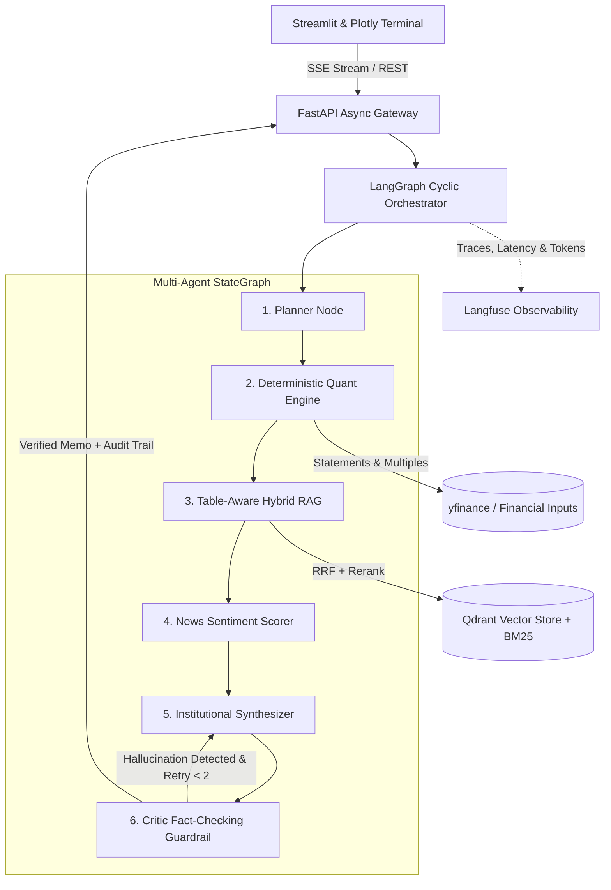

# Multi-Agent Financial Due Diligence & Quantitative Intelligence Platform

[](#running-tests--evaluation-benchmark)
[](https://www.python.org/)
[](https://github.com/langchain-ai/langgraph)
[](https://fastapi.tiangolo.com/)
[](https://qdrant.tech/)

An institutional-grade **AI Engineering & Quantitative FinTech** platform that automates equity due diligence by combining **deterministic financial ratio computation**, **table-aware Hybrid RAG (Qdrant + BM25 + Reranking)**, and a **cyclic LangGraph Multi-Agent workflow** equipped with an automated **Critic Fact-Checking Guardrail** to eliminate numerical hallucinations.

---

## System Architecture



---

## Key Engineering Highlights

* **Zero-Arithmetic-Hallucination Design:** LLMs never compute financial ratios. A pure-Python **Deterministic Quant Engine** (`src/quant/ratio_calculator.py`) computes liquidity (`Current`, `Quick`), profitability (`Gross/Operating/Net Margins`, `ROE`, `ROA`), leverage (`Debt-to-Equity`, `Net Debt/EBITDA`), Free Cash Flow, and triggers rule-based **Quantitative Red Flags**.
* **Table-Aware Financial Hybrid RAG:** Custom PDF/Markdown parser (`src/rag/parser.py`) preserves financial tables as atomic Markdown blocks, indexes them into **Qdrant (Dense)** and **BM25 (Sparse)**, merges candidates via **Reciprocal Rank Fusion (RRF)**, and re-scores with a **Financial Reranker**.
* **Self-Correcting Cyclic StateGraph:** Built on **LangGraph** (`src/agents/graph.py`), featuring a compliance **Critic Node** that cross-audits every number and citation in the generated memo against verified JSON metrics before approving output.
* **Provider-Agnostic LLM & Embedding Layer:** Seamlessly switches between **OpenAI**, **Groq (`Llama-3.3-70B`)**, and local **Ollama (`Qwen2.5` / `nomic-embed-text`)** via environment configuration.
* **Real-Time SSE Streaming & Tracing:** FastAPI `/api/v1/analyze/stream` streams node-by-node execution updates to the interactive UI while logging execution traces to **Langfuse**.

---

## Ablation Benchmark & Quality Gate Results

Evaluated via `evaluation/run_benchmark.py` across institutional due diligence scenarios (including short-term bond maturities, heavy capex commitments, and distressed covenant breaches):

| Architecture Variant | Context Precision | Context Recall | Faithfulness | Answer Relevance | Self-Correction Rate |
| --- | :---: | :---: | :---: | :---: | :---: |
| **1. Dense-Only RAG (No Reranker / No Critic)** | 0.5000 | 0.5000 | 0.2500 | 0.1458 | 0.00% |
| **2. Hybrid RAG + Reranker (No Critic Loop)** | 1.0000 | 1.0000 | 1.0000 | 0.9167 | 0.00% |
| **3. Full Multi-Agent + Hybrid RAG + Critic** | **1.0000** | **1.0000** | **1.0000** | **0.9167** | **100.00%** |

> Automated GitHub Actions Quality Gate (`.github/workflows/eval-benchmark.yml`) enforces `Faithfulness >= 0.95`, `Context Recall >= 0.90`, and `Answer Relevance >= 0.85` on every Pull Request modifying core AI modules.

---

## Project Structure

```text
├── .github/workflows/
│   ├── ci.yml                     # Automated Ruff lint, format check & Pytest suite
│   └── eval-benchmark.yml         # Automated Ragas-aligned PR quality gate
├── docker/
│   ├── Dockerfile.api             # FastAPI backend container
│   ├── Dockerfile.ui              # Streamlit terminal container
│   └── docker-compose.yml         # Postgres, Qdrant, Redis, API & UI stack
├── evaluation/
│   ├── datasets/                  # Ground-truth financial benchmark cases
│   ├── metrics.py                 # Context Precision, Recall, Faithfulness, Relevance
│   ├── run_benchmark.py           # Reproducible ablation benchmark runner
│   └── benchmark_results.md       # Latest benchmark output table
├── src/
│   ├── agents/                    # LangGraph state, nodes, prompts & LLM factory
│   ├── api/                       # FastAPI REST & SSE streaming endpoints
│   ├── core/                      # Pydantic settings & Langfuse tracing
│   ├── quant/                     # Financial data fetcher & deterministic ratio engine
│   ├── rag/                       # Table-aware parser, Qdrant store, BM25 RRF & reranker
│   └── ui/                        # Streamlit + Plotly interactive terminal
└── tests/
    ├── unit/                      # Isolated unit tests for Quant, RAG, Agents, Eval & UI
    └── integration/               # End-to-end FastAPI & SSE streaming tests
```

---

## Quickstart

### 1. Local Execution with `uv`

```bash
# Clone repository and install dependencies
git clone https://github.com/thaitrongdang/Multi-Agent-Financial-Due-Diligence-Quantitative-Intelligence-Platform.git
cd Multi-Agent-Financial-Due-Diligence-Quantitative-Intelligence-Platform

cp .env.example .env
uv sync

# Terminal 1: Start FastAPI Backend
uv run uvicorn src.api.main:app --reload --port 8000

# Terminal 2: Start Interactive Streamlit Terminal
uv run streamlit run src/ui/app.py --server.port 8501
```

Open `http://localhost:8501` in your browser and select any **Interactive Benchmark Preset** (`FPT.VN`, `HPG.VN`, `RISK.VN`) for an instant one-click demo, or enter any live ticker (`AAPL`, `MSFT`, `NVDA`).

### 2. Full-Stack Deployment with Docker Compose

```bash
cp .env.example .env
docker compose -f docker/docker-compose.yml up --build -d
```

* **Interactive UI:** `http://localhost:8501`
* **FastAPI Swagger Docs:** `http://localhost:8000/docs`
* **Qdrant Dashboard:** `http://localhost:6333/dashboard`

---

## Running Tests & Evaluation Benchmark

```bash
# Run linter, formatter check, and full unit/integration test suite
uv run ruff check .
uv run pytest -v

# Run reproducible ablation benchmark
uv run python -m evaluation.run_benchmark
```